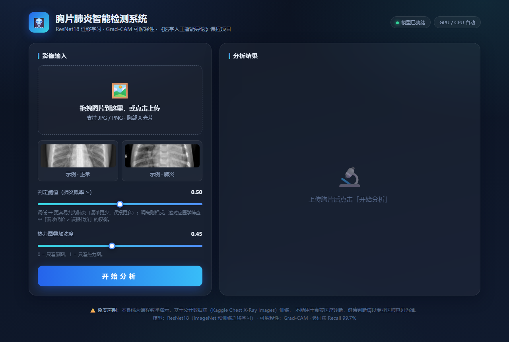
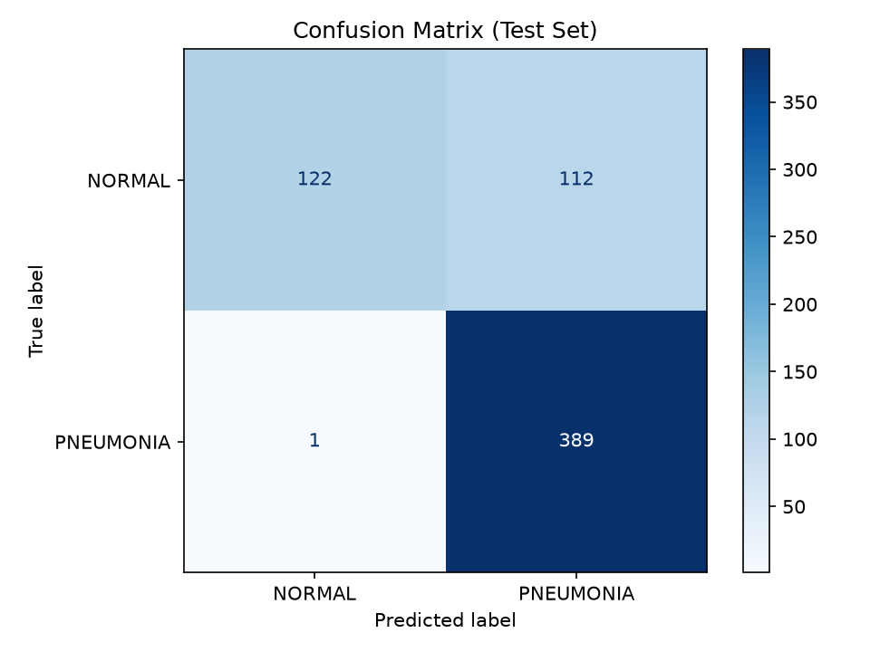
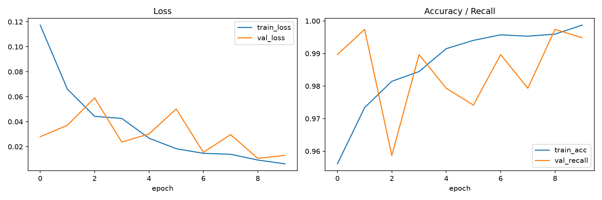
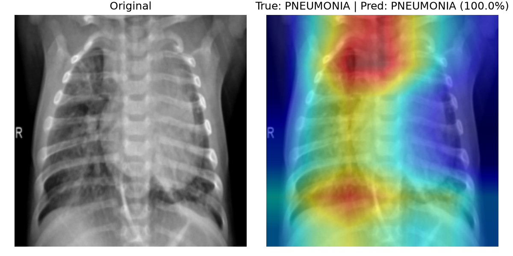

<div align="center">

# 🩺 基于迁移学习与 Grad-CAM 的胸片肺炎检测系统

《医学人工智能导论》课程项目 · 软件工程专业


**输入胸部 X 光片 → 正常/肺炎判断 + 置信概率 + Grad-CAM 可解释性热力图**

上传胸片，模型实时给出判断，并用热力图展示「它为什么这么判」。



</div>

## 目录

- [项目动机](#1-项目动机)
- [数据集](#2-数据集)
- [方法](#3-方法)
- [实验结果](#4-实验结果)
- [可解释性分析](#5-可解释性分析)
- [快速开始](#6-快速开始)
- [项目结构](#7-项目结构)
- [局限性与伦理声明](#8-局限性与伦理声明model-card)
- [未来工作](#9-未来工作)

## 1. 项目动机

肺炎是最常见的呼吸系统疾病之一，胸片是最廉价、最普及的检查手段，但判读高度依赖放射科医生经验，基层医疗机构存在漏诊风险。本项目探索用深度学习构建**计算机辅助诊断（CAD）**工具，辅助医生快速筛查，而非替代医生。

## 2. 数据集

| 项目 | 说明 |
|---|---|
| 来源 | [Chest X-Ray Images (Pneumonia)](https://www.kaggle.com/datasets/paultimothymooney/chest-xray-pneumonia)（Kaggle，来自广州妇女儿童医疗中心） |
| 规模 | 5,863 张标注胸片（训练 5,216 / 测试 624） |
| 类别 | NORMAL（正常）/ PNEUMONIA（肺炎） |
| 预处理 | 原验证集仅 16 张，从训练集按 9:1 重新切分（随机种子 42，保证可复现） |

## 3. 方法

- **迁移学习**：ImageNet 预训练 ResNet18，替换最后的全连接层为 2 类输出，微调训练
- **类别不平衡处理**：训练集中正常:肺炎 ≈ 1:3，采用逆频率加权交叉熵损失（权重 [1.94, 0.67]）
- **差分学习率**：网络主体 lr=1e-4（保护预训练知识），新分类头 lr=1e-3
- **数据增强**：随机水平翻转、±10° 旋转
- **可解释性**：Grad-CAM 类激活热力图，可视化模型决策依据

## 4. 实验结果

| 指标 | 数值 |
|---|---|
| Accuracy | 0.8189 |
| Precision | 0.7764 |
| **Recall（重点指标）** | **0.9974** |
| F1-Score | 0.8732 |

| 混淆矩阵 | 训练曲线 |
|---|---|
|  |  |

**为什么重点看 Recall？** 在医学筛查场景中，把肺炎患者误判为正常（漏诊，假阴性）的代价远高于把正常人误判为肺炎（误报，假阳性）——后者只需进一步检查即可排除。Recall 衡量的正是「真实患者中被查出来的比例」。

## 5. 可解释性分析



热力图高亮区域即模型判断的依据。理想情况是亮区覆盖肺部病灶（实变阴影区）；若亮区出现在图像边缘、文字标注等无关区域，则提示模型可能学到了「捷径特征」，需要重新审视数据质量。

**实际观察**：上图（真实=肺炎，预测=肺炎，置信度 100%）中，模型关注区域集中于双肺中上野的实变浸润区，与放射学上肺炎的表现部位一致，说明模型确实在学习病灶特征而非图像角落的标注文字。同时观察到 Accuracy (0.82) 明显低于 Recall (0.997)，即模型倾向于「宁可错杀不可放过」——在加权损失（少数类权重 1.94）的作用下，模型把部分正常人误判为肺炎以避免漏诊。这正是医学筛查场景「漏诊代价 > 误报代价」这一先验在模型行为上的体现，但较高的误报率也会增加复查负担，实际部署中可通过调整判定阈值在两者间权衡。

## 6. 快速开始

```bash
# 1. 创建虚拟环境（推荐 Python 3.10+）
python -m venv .venv
.venv\Scripts\activate        # Windows
# source .venv/bin/activate   # macOS/Linux

# 2. 安装依赖
pip install -r requirements.txt

# 3. 下载数据集
# 从 Kaggle 下载并解压，把 chest_xray 文件夹放入 data/ 目录

# 4. 数据准备（检查 + 重新切分验证集）
python src/prepare_data.py

# 5. 训练（CPU 约 1~2 小时，有 GPU 约 10 分钟）
python src/train.py

# 6. Grad-CAM 可视化
python src/gradcam.py

# 7. 启动网页 Demo（自研前端：FastAPI + 原生 JS）
python app/server.py
# 浏览器打开 http://127.0.0.1:7860

# （备选）Gradio 简易版 Demo
python app/app.py
```

**Web 界面功能**：暗色玻璃拟态医疗风格 UI · 拖拽/点击上传 · 一键示例图片 ·
**判定阈值滑块**（实时体验「漏诊 vs 误报」权衡）· Grad-CAM 热力图叠加浓度调节 ·
环形置信度仪表盘 · 会话历史记录。

## 7. 项目结构

```
pneumonia-detection/
├── data/                  # 数据集（不入库）
├── src/
│   ├── prepare_data.py    # 数据检查与验证集重切分
│   ├── train.py           # 迁移学习训练 + 评估
│   └── gradcam.py         # Grad-CAM 可视化
├── app/
│   ├── server.py          # FastAPI 后端（预测 + Grad-CAM API）
│   ├── static/index.html  # 自研单页前端（暗色医疗风 UI）
│   └── app.py             # Gradio 简易版 Demo（备选）
├── models/                # 模型权重（不入库，运行 train.py 自动生成）
├── results/               # 指标、图表输出
└── requirements.txt
```

## 8. 局限性与伦理声明（Model Card）

- **非诊断工具**：本模型仅供教学演示，**不可用于任何真实医疗场景**，不能替代执业医师的判读。
- **数据局限**：训练数据来自单一医院（儿童居多），对成人、其他人群、其他设备的胸片泛化能力未经验证。
- **类别不平衡**：虽然采用加权损失缓解，但测试集中两类数量仍不均衡，指标解读需结合混淆矩阵。
- **隐私声明**：数据集为已公开的去标识化研究数据，本项目未涉及任何真实患者隐私信息。
- **潜在偏差**：若热力图显示模型关注图像角落等无关区域，说明可能存在数据捷径学习，实际部署前必须排查。

## 9. 未来工作

- 尝试 EfficientNet / DenseNet 等更强骨干网络并做对比实验
- 处理类别不平衡的更多手段（Focal Loss、过采样）
- 引入外部验证集检验跨医院泛化能力
- 增加「细菌性肺炎 vs 病毒性肺炎」三分类任务
